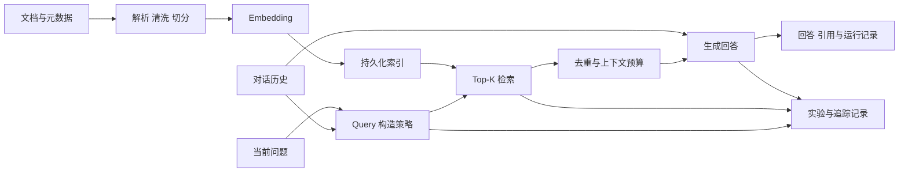

# 系统架构与接口设计

## 1. 目标与边界

系统支持导入文档、构建可追溯索引、进行多轮检索问答，以及运行可复现的离线评测。优先满足单机开发和课程实验；服务拆分、分布式索引和多租户属于可扩展方向，不在第一版中假定已经实现。

开发期不要求本地 GPU：生成模型可调用 Qwen API，Embedding 可通过远程服务或经资源验证后使用小型 CPU 模型。服务器可用后接入自部署推理服务。具体模型、服务地域、上下文窗口、成本及许可证在实现和实验时固定并记录。

## 2. 总体流程



离线索引和在线查询分开：索引构建生成不可变的索引版本及清单；查询指定版本。一次请求固定会话快照、Query 策略、索引版本和模型配置。

## 3. 模块及契约

| 模块 | 输入 | 输出与责任 |
|---|---|---|
| 文档导入 | 文件或数据集记录 | 标准文档：稳定 ID、正文、来源、标题、许可信息及内容哈希；解析失败可报告 |
| 切分 | 标准文档、切分配置 | Chunk ID、文本、文档 ID、位置与元数据；相同输入及配置得到稳定结果 |
| Embedding | 文本批次、模型配置 | 向量及模型标识、维度；批次失败可定位和重试 |
| 索引 | Chunk、向量、索引配置 | 可持久化索引及清单；检查模型、维度、归一化和距离度量兼容性 |
| 会话 | 会话 ID、消息 | 按顺序持久化的消息；对话历史与检索证据分开管理 |
| Query 构造 | 当前问题、历史快照、策略配置 | 检索 Query、策略名及状态；失败时按配置回退并记录原因 |
| 检索 | Query、索引版本、Top-K | 有序候选及分数、Chunk ID 和来源；分数含义取决于检索器 |
| Reranker | Query、候选 | 重排结果；可关闭，失败策略可配置 |
| 上下文构造 | 候选、预算 | 去重后的证据片段、引用编号、截断记录 |
| 生成 | 问题、历史、证据、生成配置 | 回答、引用、模型与用量；无充分证据时允许明确拒答 |
| 评测 | 固定数据与运行配置 | 每条记录的中间结果、指标、异常与汇总 |

接口以领域数据类型为边界，不把某一厂商 SDK 类型传遍业务层。生成、Embedding 和 Reranker 分开选择；不同服务的超时、限流、响应格式和参数兼容性由适配器处理。

## 4. 生成模型切换

配置示意（字段和默认值将在实现时固定）：

```yaml
generation:
  provider: openai_compatible
  base_url: ${LLM_BASE_URL}
  api_key_env: LLM_API_KEY
  model: ${LLM_MODEL}
  timeout_seconds: 60
  max_retries: 2
embedding:
  provider: ${EMBEDDING_PROVIDER}
  model: ${EMBEDDING_MODEL}
retrieval:
  index_version: ${INDEX_VERSION}
  top_k: 5
query:
  strategy: current  # current / history / rewrite
```

开发时填写 Qwen API 的地址、密钥和具体模型；服务器部署兼容服务后切换地址与模型。此入口不保证所有服务功能一致，应验证消息格式、生成参数、错误响应、上下文长度和用量统计。改用不同 Embedding 模型、维度或预处理方式时必须建立新索引，不能混用已有向量。

## 5. 存储与运行

第一版建议使用本地持久化向量索引和 SQLite 存储会话、文档清单及运行元数据，文件置于可配置的数据目录。检索后端由接口隔离，具体库在阶段二依据 Windows/CPU 兼容性与实际测试确定；未来可替换为独立向量数据库。HTTP API 使用 FastAPI，命令行覆盖导入、索引构建、查询和评测。实验记录与大文件不默认提交版本库。

目标目录：

```text
src/  配置、领域模型、导入、索引、检索、对话、模型适配、API
tests/  单元、集成及端到端测试
configs/  配置示例和实验配置
scripts/  数据准备、索引构建与实验入口
data/  本地数据与索引（不提交大文件）
experiments/  运行清单与结果（大文件不提交）
docs/  设计、部署与实验文档
```

## 6. 可靠性与安全边界

- 密钥由环境变量或部署环境的密钥管理提供，不写入日志或配置示例。
- 日志默认避免记录密钥及完整敏感文本；实验文本记录应可配置并受存储权限保护。
- 外部模型调用设置超时、有限重试和错误分类；限流或失败不能伪装为成功。
- 将检索内容视作不可信数据：提示模型仅用其作为证据，服务端保留来源并检查引用编号是否存在；这不能保证完全防御提示注入或证明回答真实。
- 对输入大小、上下文预算和并发设置明确限制；部署公开服务前需增加身份认证、授权、网络隔离和运维监控。
- 索引构建使用临时产物和完整性检查，成功后再发布版本；保留可回滚的清单和备份方案。

## 7. 待实施时确认

具体云端模型、Embedding 服务、向量索引库、文档格式和部署拓扑需根据 API 可用性、费用、数据许可及服务器配置确定。研究报告必须标明 API 模型与实际部署的开放权重模型，不能仅因使用 Qwen API 就声称所有实验使用了开放权重模型。
